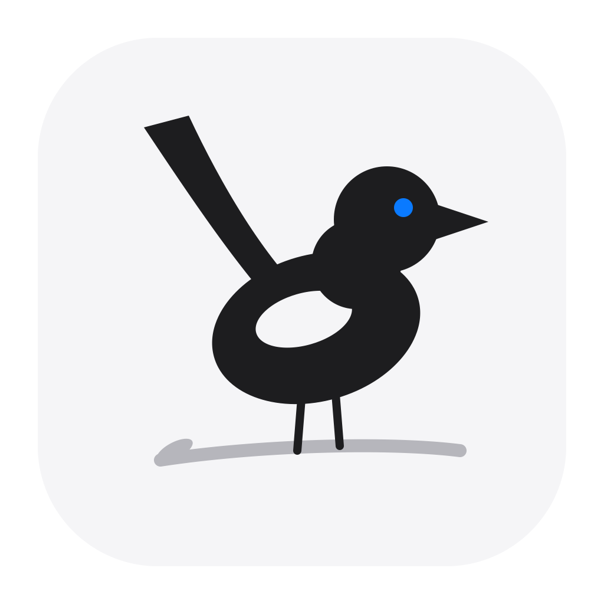
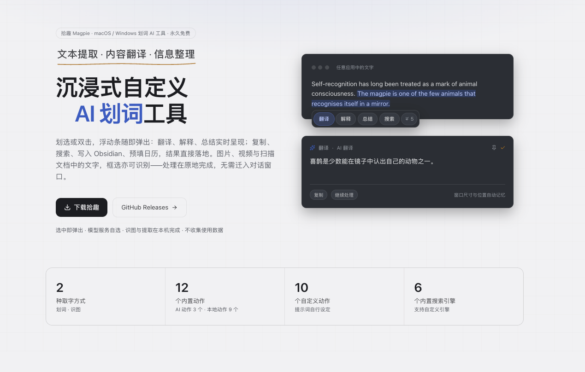
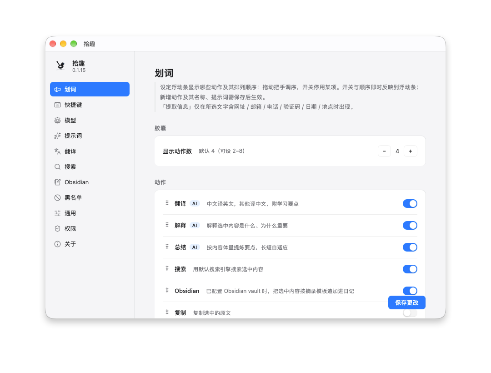
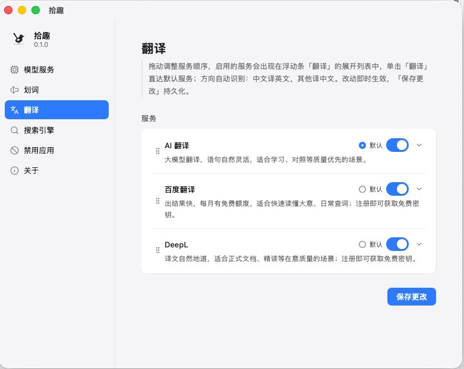
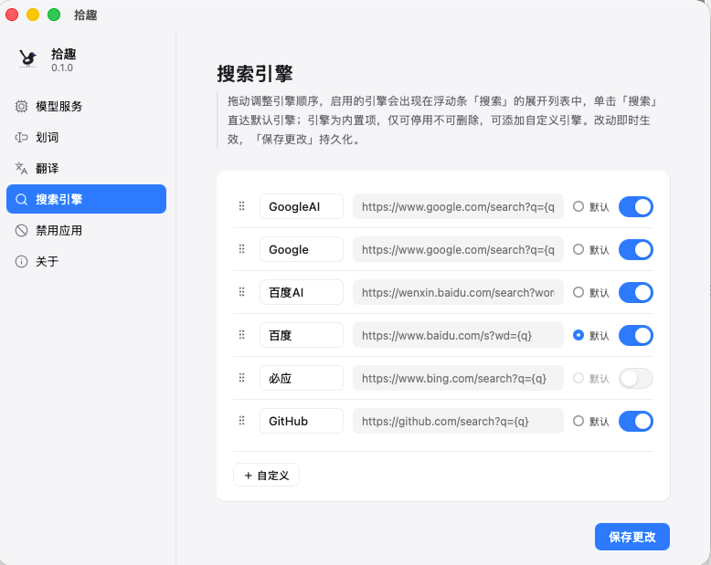

<div align="center">



# Magpie (拾趣)

**Understand as you read** — the entry hub for the first text source, triggered by your mouse

Every piece of text on your screen is one mouse gesture away: select or capture it, and actions return results in place — processed where you saw it, landed where you want it.

[](#)
[](#)
[](#)
[](#)
[](./LICENSE)

[简体中文](./README.zh-CN.md) | [English](./README.md)

</div>

---

## Introduction

**Magpie (拾趣)** is the entry hub for the first text source, triggered by your mouse. Select text or capture the screen in *any* app on macOS or Windows and a floating bar instantly offers translate / explain / summarize with streaming output. Unlike pure selection tools, Magpie covers all visible text with a dual pipeline (selection + OCR capture) — zero-cost capture via Accessibility APIs (macOS) or UI Automation (Windows) with a compatibility-mode fallback that restores the clipboard. Models are BYOK and never locked in; downstream, it connects to the professional tools you already use — **integrate, don't rebuild**.

**Website**: [demo007x.github.io/Magpie](https://demo007x.github.io/Magpie/) — product intro & screenshots

## Screenshots





<p align="center">
  
  
</p>

## Features

<!-- This section lists CAPABILITIES only: what the product can do, one line each
     (what it is + how to trigger it). Do NOT add: performance numbers ("xx ms"),
     micro-interactions (shortcuts, dismiss behavior), resilience or optimization
     notes (helper-process isolation, caching) — those belong to the CHANGELOG's
     Changed/Fixed entries, or nowhere at all. Update this section only when a
     capability changes; releases do not touch it. -->

- **Global selection capture** — select text in any app to trigger the bar; drag-select or double-click both work
- **Floating bar** — pops above the mouse cursor, auto edge-clamping, never steals focus; light / dark / follow-system themes; native per-card shadows on Windows
- **Eleven actions** — Translate / Explain / Summarize (AI-generated, streamed) + Copy / Search / Open Link / Compose Email / Copy Code / Copy Phone + Add to Calendar / Open in Maps; order and visibility configurable in settings
- **Context-aware actions** — links, emails, verification codes, phone numbers, dates and places in the selected text are detected automatically: a single entity is one click away (open / compose / copy / calendar / maps), multiple entities open a grouped panel for batch operations; with a model service configured, dates and places are understood by the AI in context (date ranges, event titles), and calendar events carry the source link, selected text and invitees
- **Save to Obsidian** — write the selection or OCR result straight into your vault as a daily-note excerpt, a task line or a knowledge card, each with its own template; no Obsidian plugin required
- **Screen OCR** — a custom global hotkey or the tray menu starts a region capture, on-device OCR reads the text, with one-step OCR translate / explain / summarize; Snipaste-style pinned images can loop back into OCR
- **Result window** — AI results and recognized text open in a standalone persistent window that can be pinned, dragged, and remembers position & size, with default-size presets in the appearance settings
- **Custom AI actions** — a name + prompt + icon become capsule buttons (up to 10, ordered with the built-ins), with a try-run preview
- **Dedicated permissions page (macOS)** — Accessibility, Input Monitoring, and a capture health check in one place, with one-click guided authorization; the Windows build needs no permission grants
- **Ten translation channels** — AI translation (LLM) plus nine machine-translation engines: Google, Microsoft, DeepL, Baidu, Youdao, Tencent, Alibaba, Volcengine and Caiyun; click runs the default, the chevron lists them all, and services can be added, paused or reordered anytime
- **Custom search engines** — ships with Baidu AI / Baidu / Google AI / Google / Bing / GitHub; any `{q}` URL template works
- **BYOK model services** — bring your own API key; one-click presets for DeepSeek, Volcengine (Doubao), Zhipu, Kimi, Qwen, Xiaomi MiMo, SiliconFlow, OpenAI, xAI and OpenRouter, plus any OpenAI-compatible endpoint — in both Chat Completions and OpenAI Responses forms; the prompts behind Translate / Explain / Summarize are customizable
- **Tray resident** — lives in the menu bar (macOS) / system tray (Windows); closing the main window just hides it while capture keeps running; GitHub update notifications
- **App blocklist** — selection is disabled inside terminals, password managers, and other sensitive apps; system apps are reliably covered
- **Compatibility mode (macOS)** — text selection also works in WeChat, Office, and similar apps, without disturbing your clipboard contents

## Prerequisites

- macOS 13+ (Apple Silicon or Intel) or Windows 10+ (x64)
- Rust 1.80+ — macOS: Xcode Command Line Tools; Windows: MSVC build tools (Visual Studio or Build Tools)
- Node 20+
- pnpm

## Getting Started

```bash
# Install Rust via rustup if not present (Prerequisites require Rust 1.80+;
# without it `pnpm tauri dev` fails with "No such file or directory" on cargo)
curl --proto '=https' --tlsv1.2 -sSf https://sh.rustup.rs | sh

# Clone and install dependencies
git clone https://github.com/demo007x/Magpie.git
cd Magpie
pnpm install

# Run in development mode (starts vite on :5173)
pnpm tauri dev
```

1. **Accessibility permission (dev mode, macOS)**: the unpacked dev binary won't appear in the Accessibility list automatically. Add the **terminal app** running `tauri dev` (Terminal / iTerm2 / VS Code) under System Settings → Privacy & Security → Accessibility. Not an issue for the packaged .app. On Windows, no permission grants are needed
2. Drag-select or double-click text in **any app** → the floating bar appears
3. Add a model service on the **Model** page — pick a preset, paste your key, confirm the model name — or point it at any OpenAI-compatible endpoint; add translation services with their keys on the **Translate** page
4. Click Translate / Explain / Summarize → streaming results

## Commands

```bash
pnpm check              # TS type check (tsc --noEmit)
pnpm build              # tsc + vite build → dist/
pnpm tauri dev          # development run
pnpm tauri build        # package the app
cargo check             # Rust check (run in src-tauri/)
cargo build             # Rust link verification
```

## Architecture

**Design principle: Rust owns the stable parts, TypeScript owns the fast-moving parts.**

```
TS (WebView × N)                          Rust core process
├─ main (index.html)  settings/self-check ├─ capture/  selection capture (macOS: CGEventTap + AX · Windows: mouse hook + UIA)
│    └─ invoke: get/save_settings         ├─ floating.rs  floating-bar window mgmt (one card per window on Windows)
├─ floating (floating.html) bar           ├─ settings.rs  JSON config + blocklist
│    └─ action registry (ACTIONS)→prompt  ├─ ai.rs  dumb OpenAI SSE pipe
│    └─ aiChat() → Channel stream         └─ main.rs  setup/tray/event dispatch
```

Data flow: platform capture (macOS: CGEventTap + AX · Windows: low-level mouse hook + UI Automation) → detect thread (gates / selection query) → filter (own PID / blocklist / duplicates) → event `selection://captured` → floating bar → user picks an action → prompt built in TS → Rust pipes SSE → streamed rendering.

- AI traffic goes through a dumb Rust pipe instead of direct WebView fetch, avoiding CORS issues with third-party BYOK endpoints. All prompts/actions live in the TS layer — adding an action = registering one object, zero Rust changes.
- Platform dispatch is abstracted: `capture/` picks a backend via `#[cfg]`, and both backends share one signature — macOS (CGEventTap + AX) and Windows (WH_MOUSE_LL hooks + UI Automation) both ship.

## Privacy & Security

- macOS: selection is read via Accessibility APIs by default; the built-in compatibility mode simulates ⌘C and restores the clipboard afterwards
- Windows: selection is read via UI Automation (WH_MOUSE_LL hooks) — no clipboard use and no system-permission grants; apps running as administrator are out of reach (UIPI)
- API keys are stored in plaintext in local `settings.json` (moving to the system keychain in M2) and are sent only to the LLM / translation endpoints you configure
- No telemetry, no accounts

## Feedback

Run into a problem or have an idea? Scan the QR code (Feishu form, no account needed) or [open it directly](https://tvxjr8zl48.feishu.cn/share/base/form/shrcnF78Kl495G3iUVz8iWvnA6e). In the app, **设置 › 关于 › 反馈问题** (also in the tray menu) jumps to the form or to [GitHub Issues](https://github.com/demo007x/Magpie/issues), and **复制日志** copies the run log to paste with your report. A web page can open that panel directly via `magpie://feedback`.

<p>
  
</p>

## Roadmap

See [ROADMAP.md](ROADMAP.md) for the full, self-contained roadmap. Top priorities (M2): **clip-to-collection** into Notion / flomo / Apple Notes (Obsidian shipped in v0.1.9; custom AI actions in v0.1.6), follow-up Q&A in the result window, AI search & Q&A, context-aware selection, and moving API keys to the system keychain. Windows capture (UIA backend) shipped in v0.1.14. Mid-term (M3) converges built-ins, custom actions, integrations, and workflows into one unified action model; long-term (M4) adds hosted models for zero configuration.

> The architecture already reserves hooks for these capabilities (platform capture backends, the action registry); they will land milestone by milestone.

## Docs

Design documents are written in Simplified Chinese:

| Doc                                                              | Content                                              |
| ---------------------------------------------------------------- | ---------------------------------------------------- |
| [docs/01-产品定位与规划.md](docs/01-产品定位与规划.md)           | Positioning, users, principles, roadmap, monetization |
| [docs/02-架构设计.md](docs/02-架构设计.md)                       | Layered architecture, data flow, protocol, evolution |
| [docs/03-模块设计.md](docs/03-模块设计.md)                       | Capture / windows & UI / AI service layer            |
| [docs/04-技术选型.md](docs/04-技术选型.md)                       | ADR decision records                                 |
| [docs/05-MVP执行计划.md](docs/05-MVP执行计划.md)                 | M1 execution history                                 |

## Contributing

Issues and PRs are welcome! See [CONTRIBUTING.md](CONTRIBUTING.md) (written in Simplified Chinese) for the contribution process, local verification standards, and engineering conventions.

## License

Released under the [MIT](./LICENSE) license.
