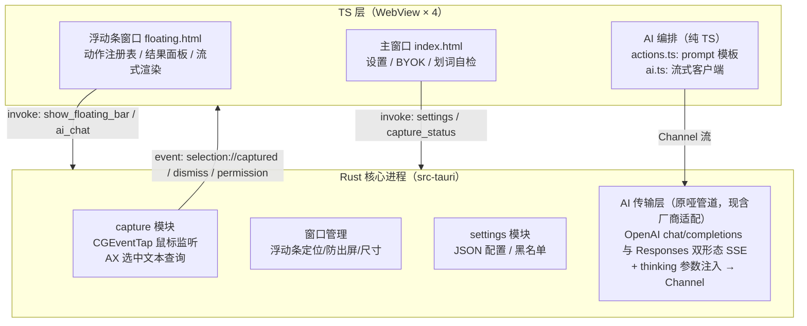
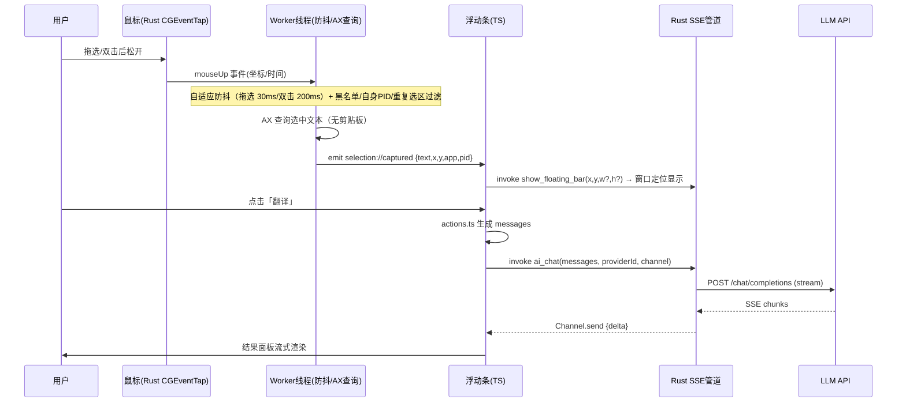

# 拾趣 · 架构设计

> v2.0 · 2026-09-19 · 配套 [01-产品定位与规划](./01-产品定位与规划.md) / [03-模块设计](./03-模块设计.md) / [04-技术选型](./04-技术选型.md)

## 1. 总体原则

1. **Rust 管不变的，TS 管多变的**：系统层（捕获/窗口/存储/传输）放 Rust——五年不随 AI 演进变化；AI 编排（动作、prompt、流式渲染、未来 agent）放 TS（WebView 内）——蹭 npm 生态的迭代速度。
2. **无障碍优先**：数据获取默认只走无障碍 API；兼容模式（常开兜底）在 AX 失败时模拟 ⌘C 取词并自动还原剪贴板。
3. **热路径零框架**：划词→弹条→流式首字这条链上不引入任何 AI 框架，保证延迟与体积。
4. **契约面最小**：Rust ↔ TS 之间只通过 Tauri command（请求/响应）+ event + Channel（流）三种通道通信，热路径契约面保持最小；全量命令清单以 `src-tauri/src/main.rs` 的 invoke_handler 注册为准。

## 2. 分层架构



### 进程与窗口模型

| 窗口 | label | 特性 | 生命周期 |
|---|---|---|---|
| 主窗口 | `main` | 880×620（min 780×520，tauri.conf.json），常规装饰 | 常驻（可关闭=隐藏） |
| 浮动条 | `floating` | 无边框/透明/置顶/不进任务栏/不抢焦点 | 常驻隐藏，选词时 show + 定位 |
| 识别/结果窗 | `ocr` | 复用 floating.html，无边框/透明/置顶/不抢焦点 | 常驻隐藏，OCR 取词/结果展示时 show |
| 全局提示 | `toast` | toast.html，无边框/透明/置顶/不抢焦点 | 常驻隐藏，notify 时 show |

> 浮动条采用「预建 + show/hide」而非每次 new window：省 50~100ms 创建延迟。

> Windows 下另有 `floating-panel` / `floating-menu` 两扇动态预建窗口（分离卡弹层，见 [03-模块设计 §B.1.1](./03-模块设计.md)）。

## 3. 关键数据流

### 3.1 划词→弹条→流式结果（热路径）



### 3.2 事件与命令协议（Rust ↔ TS 契约）

**Events（Rust → TS）**

| 事件 | 载荷 | 说明 |
|---|---|---|
| `selection://captured` | `{text, x, y, app, pid}` | 有效新选区（pid 供 pageurl 反查来源页面 URL）。`app="ocr"` 为合成事件（text 空、坐标 -1），实际内容经 `ocr_take_pending` 拉取：PendingResult 带 `vision` 标志，true = 文本未识别，前端直接把截图送模型（流前失败回退 `ocr_recognize_local`）；另带 `barcodes`（截图里本机解码出的二维码载荷，rqrr 纯 Rust 实现、与 OCR 并行跑，前端在识别/提取面板展示为「二维码」组） |
| `snip://captured` | `{x, y, w, h}` | 截图胶囊：框选完成、截图已拍、动作未选（macOS 识图取字路径）。载荷 = 框选矩形（全局逻辑坐标），胶囊按选区右下角锚定（emit_to 定向 floating 窗） |
| `snip://frame` | `{x, y, w, h}` | 截图遮罩 select→session 切换（载荷 = 选区矩形，遮罩窗视口逻辑坐标）。选区交互发生在遮罩页自身，监听已注册、无竞态 |
| `selection://dismiss` | `{}` | 单击空白（浮动条可见时才发），浮动条隐藏 |
| `capture://permission` | `{granted}` | 辅助功能授权状态变化（启动/自检时查询后发） |
| `hover://move` | `{x, y}` | 鼠标位置（**目标窗口视口坐标**，Rust 按光标落点在悬浮胶囊/结果窗之间路由，光标落在 Windows 分离卡弹层内也路由给胶囊窗口（坐标按胶囊原点换算）以维持驻留收起判定，~60Hz 节流），供前端合成 hover 与二级浮层 hover 驻留展开——非 key 窗口收不到 mouseMoved、WebKit 只给活动页面渲染 :hover |
| `hover://left` | `{}` | 光标从全部 hover 目标窗口（胶囊/结果窗/Windows 分离卡弹层）划出的瞬间补发一次给最后命中的窗口——分离卡下胶囊文档看不到弹层窗口边界，光标从弹层直接划走时收不到 mouseleave，二级浮层「延迟收起」靠这条边沿起算 |
| `floating://pop` | `{open, data}` | Windows 分离卡：向 `floating-panel` / `floating-menu` 推送二级浮层渲染数据（哑渲染端，结构见 docs/03 §B.1.1） |
| `floating://pick` | `{kind, key, rowY}` | Windows 分离卡：弹层窗口回传胶囊窗口执行（`action` / `menu-toggle` / `row-hover`（行 hover 变化上报，行命中在面板窗口检测、决策在胶囊）/ `pick:translate` / `pick:search` / `pick:obsidian`；rowY = 行侧菜单锚点） |
| `update://available` | `{status, current, latest?, url?, notes?, checkedAt}` | 更新检测结果（update.rs；启动后台检查与关于页手动检查后广播，status = available / upToDate / cooldown / failed；主窗口监听并弹确认弹窗，notes 为更新说明 markdown 内嵌展示，检测走 updater 清单 + minisign 验签） |
| `update://progress` | `{transferred, total?}` | 更新包下载进度（update.rs update_install 回调；仅主窗口更新弹窗消费，按钮播百分比） |
| `ocr://error` | `message`（字符串） | OCR 子进程识别失败提示（ocr.rs） |
| `nav://page` | `page`（字符串） | 定向发主窗口的页内导航（托盘菜单跳转指定设置页，如 `model`） |
| `tts://progress` | `{stage, percent}` | 朗读音色包下载/安装进度（stage = `engine` / `model` / `extract`；speech.rs） |
| `tts://end` | — | 一次朗读结束（读完全部内容、被打断或合成失败）；定向发给发起朗读的窗口，前端据此把声波图标复位为喇叭 |

**Commands（TS → Rust）**

> 本表只覆盖划词/结果窗热路径契约；全量命令（OCR、钉图、翻译 ×9、更新检测、应用选择等）以 `src-tauri/src/main.rs` 的 invoke_handler 注册清单为准。

| 命令 | 参数 | 返回 |
|---|---|---|
| `show_floating_bar` | `x, y, w?, h?, snipRect?` | 返回 `WindowPos`（实际落位，以 Rust 钳制为准）：普通划词跟随鼠标上方（胶囊水平中心对光标、卡片底边距光标 16px，屏顶放不下落到下方）；`snipRect` = 框选矩形，按选区右下角锚定（右缘对齐选区右缘、下方 8pt，放不下翻上方）。均含防出屏钳制 |
| `resize_floating` | `width, height, x?, y?` | 返回 `WindowPos`：展开结果面板时调整尺寸并保持不出屏 |
| `hide_floating_bar` | — | 隐藏 |
| `snip_execute` | `actionId` | 截图胶囊动作执行：挂起截图移交钉图槽位 → OCR 识别（与二维码解码并行）→ 结果窗导流（`ocr` = 只出文本；`qr` = 只解码二维码不跑文字识别，helper `--qr` 模式；`translate`/`explain`/`summarize` = 识别后自动执行，翻译服务 Rust 侧解析默认项）；选区拖动过时按新矩形重截当前屏幕 |
| `snip_cancel` | — | 取消截图胶囊会话：删除挂起的截图临时文件并关闭遮罩（dismiss/点选区外时前端先行调用） |
| `snip_region_selected` | `x, y, w, h` | 遮罩窗选区完成（页面松手上报，遮罩视口逻辑坐标）：静默截图后按槽位分流——无动作进胶囊会话（发 snip://frame 切会话模式），有动作立即识别执行 |
| `snip_region_cancel` | — | 选区阶段取消（过小选区误触等，页面调用）：整段流程终止 |
| `ocr_recognize_local` | `path` | 本地识别截图（视觉分流流前失败的前端回退）：spawn_blocking 包 recognize_file，macOS 含「未识别到文字」自愈重截（重截成功替换 OCR_IMAGE 供钉图）；返回 `{text, barcodes, image?}`（barcodes = 二维码载荷，image = 重截后的新路径） |
| `ocr_image_data_url` | `path` | 截图转 data URL（视觉 LLM 请求体用）：长边超 1568 等比缩小、JPEG 压缩、base64 封装；返回 `data:image/jpeg;base64,…` |
| `snip_frame_move` | `x, y, w, h` | 会话内选区拖动（页面上报）：更新会话矩形 + 胶囊实时跟随（右下角锚定重排） |
| `ai_chat` | `messages, providerId?, channel` | 建 SSE 请求（OpenAI chat/completions 与 Responses 双形态，按厂商注入 thinking 参数），流经 Channel 推送。messages 的 content 支持多模态数组（`text` / `image_url` 分片；chat 形态透传，Responses 形态 image_url 转 `input_image`） |
| `get_settings` / `save_settings` | — / `settings` | JSON 配置读写 |
| `capture_status` | — | `{granted, axServiceOk, listenEventAccess, screenCaptureAccess, captureAvailable, platform}` |
| `request_listen_access` | — | 发起输入监控授权（系统自动注册二进制）；未通过时代开设置面板 |
| `open_accessibility_settings` | — | 打开系统设置隐私面板 |
| `entities::detect_dates` | `text` | NSDataDetector 日期实体识别（离线/确定性，中文相对时间对照当天解析），返回 `[{unix, duration, start, len}]` |
| `entities::detect_places` | `text` | NLTagger（NaturalLanguage 框架）地名 NER，`nameType` 方案的 PlaceName 标签，离线 on-device；返回地名 span 字符串数组 |
| `entities::open_in_calendar` | `start, end, title, allDay, url?, notes?, attendees?` | 本地拼 .ics 交给系统日历（预填新事件，可带链接/备注/受邀人）；时间串由 TS 计算传入，零 EventKit 权限 |
| `paths::open_local_path` | `path` | 打开/显示本机路径（仅 Windows，其余平台明确返回不支持；前端闸见 `floating/env.ts::IS_WINDOWS`）：目录 = 打开该目录；文件 = 在文件管理器里选中它；常见文档与图片扩展名放行给系统默认应用；**可执行类一律只选中、绝不启动**。收下的写法：盘符路径（`E:\a`、`E:/a`）、地址栏的 `file:///E:/a`、WSL 发行版路径（`\\wsl.localhost\<发行版>\…` 及旧别名 `\\wsl$\`——写法是 UNC，但这条命名空间由 Windows 自己提供，资源管理器原生能进，与共享盘不是一回事）；共享盘与 POSIX 写法拒绝。返回一行结果码 `opened-dir` / `opened-reveal` / `opened-app` / `missing` / `failed` / `unsupported`，前端按档位各说一句真话（刻意不用异常：选到已移走的旧路径是常态）。显隐判据在前端（`textContext.extractPath`，只看语法），本命令负责二次校验与执行——走 Shell 项 API（`SHParseDisplayName` + `SHOpenFolderAndSelectItems` / `ShellExecuteW`），不经命令解释器，因此也不存在把选区文本拼进命令行的注入面 |
| `dict::dict_status` | — | 离线词库可用性：`{state, path, entryCount, version}`，`state` = `ready`（可取词）/ `unset`（未选且自动探测不到）/ `missing`（路径上的文件不在）/ `unknown`（结构不认识或读不动，**不猜结构**）。`path` 是实际生效路径（自动探测命中也回填，让用户看得见用的哪个文件）。设置页状态行与「词典」动作显隐共用一次探测；动作开关本身在 `settings.actions.dict`，关闭时 `dict_lookup` 直接给 `null` |
| `dict::dict_lookup` | `text` | 离线取词（零网络、零 API Key）：规范化词头直查，命中返回 `{headword, ipa[], senses[{pos, gloss, explanation, usageNote, examples[{text, translation}]}], memoryHook, etymology}`，未收录返回 `null`。**Rust 只给数据、渲染在 TS**（与「Rust 管不变的」一致）；词库正被词典应用并发写入或读不到时一律按未命中处理，不报错 |
| `pageurl::frontmost_web_url` | `pid`（选区来源进程，captured 事件携带） | 按 pid 直连 AX，焦点窗口 AXWebArea → AXURL（选区来源页面链接，智能提取上下文/日历 URL 字段）；pid≤0/非浏览器/非 macOS → null |
| `obsidian::obsidian_append` | `relPath, content` | 把内容追加进 vault 内相对路径文件（目录/文件不存在则创建）；路径越界 vault 即拒绝，纯本地文件写入 |
| `anki::anki_version` | `url` | 连接探测（返回 AnkiConnect API 版本）；回环请求禁用系统代理（代理截胡会把「连接被拒」伪装成 HTTP 502），失败按安装状态分层提示（`anki_installed` 探测：未安装 → 引导安装；已安装 → 引导启动） |
| `anki::anki_installed` | — | Anki 应用是否安装：macOS 查 /Applications 与 ~/Applications + Spotlight 按 bundle id（net.ankiweb.dtop）定位，Windows 查惯例安装路径；「未启动」与「插件未装」网络层不可区分，安装探测是分层提示的依据 |
| `anki::anki_deck_names` | `url` | AnkiConnect `deckNames`：牌组列表（设置页缓存） |
| `anki::anki_model_names` | `url` | AnkiConnect `modelNames`：笔记类型列表（设置页下拉缓存） |
| `anki::anki_model_fields` | `url, model` | AnkiConnect `modelFieldNames`：字段清单（建卡字段映射需实拉字段顺序） |
| `anki::anki_create_deck` | `url, deck` | AnkiConnect `createDeck`（一键配置建「拾趣」牌组用） |
| `anki::anki_create_model` | `url, model` | AnkiConnect `createModel`：一键配置创建单词卡/内容卡配套笔记类型（含出厂 CSS） |
| `anki::anki_add_note` | `url, deck, model, fields, tags` | AnkiConnect `addNote` 建卡；重复卡报错单独分类（不覆盖已有卡） |
| `anki::anki_model_styling` | `url, model` | AnkiConnect `modelStyling`：读卡型 CSS（配套卡型样式卫生升级的比对基准） |
| `anki::anki_update_model_styling` | `url, model, css` | AnkiConnect `updateModelStyling`：静默补强配套卡型出厂样式（用户改过则不动） |
| `app_picker::pick_vault_dir` | — | 目录选择面板（rfd），返回所选绝对路径；用户取消返回 null |
| `app_picker::pick_dict_file` | — | 词典文件选择面板（rfd，按词典文件后缀过滤），返回所选绝对路径；用户取消返回 null。返回后由设置页落盘再重探 `dict_status` |
| `notify` | `message, kind?` | 全局 toast 轻提示（前端侧唯一提醒通道：WKWebView 不实现 `alert/confirm`，它们是静默空操作） |
| `update::check_update` | `force` | 更新检测（updater 清单，24h 节流 + `update.json` 落盘；永不 Err，失败 = `status:"failed"`）；查到新版同时存入 managed 状态供安装 |
| `update::update_install` | — | 下载已检测的更新并安装，完成后重启应用（本命令不返回）；进度经 `update://progress` 播报，失败 Err 由前端 toast |
| `dismiss_toast` | — | 用户点 toast 立即收场（与自动隐藏同一条路径：序号推进，作废未触发的隐藏排期）。toast 窗不可聚焦但照常收点击，同胶囊收动作；`progress` 类型不响应——点掉它并不会让正在跑的识别停下来 |
| `tts_status` | — | `{supported, installed, downloading}`：朗读能力位（macOS / Windows x64）、音色包是否就绪（引擎 + 模型文件）、是否正在下载 |
| `tts_download` | — | 下载并解压引擎（sherpa-onnx：macOS universal2 / Windows x64·ARM64）与音色模型（Kokoro fp32，约 410MB）到 `appConfigDir/tts`，解压走 Rust 侧 bzip2+tar（不依赖系统命令）；过程中发 `tts://progress`，重复调用被闸门挡回 |
| `tts_speak` | `text, lang, sid?` | `lang` 传 `auto` 时按汉字占比判定中/英；`sid` 为空则取设置里该语言的默认音色（试听指定音色直接传 sid，不等设置落盘）。长文按句切块（首块 36 字尽快出声，后续 120 字让合成追上播放），2 路并发预合成、顺序播放（macOS afplay / Windows PowerShell SoundPlayer），块间不留静默；立即返回，结束发 `tts://end`（定向到调用窗口） |
| `tts_stop` | — | 打断当前合成/播放（离开朗读页、切换试听时调用） |
| `set_floating_pops` | `target, data, trigX?, rowY?` | Windows 分离卡：推送二级浮层渲染数据与锚点（target = `panel` / `menu` / `close-panel` / `close-menu` / `none`；锚点 None = 沿用上次值） |
| `pop_ready` | `width, height` | Windows 分离卡：弹层窗口量得卡片尺寸后回调，Rust 按锚点定位（贴边翻转 + 防出屏钳制）并显示（胶囊像素不动） |
| `floating_pick` | `kind, key, rowY?` | Windows 分离卡：弹层点击回传，转发 `floating://pick` 给胶囊窗口 |

**Channel 流消息（ai_chat）**

```jsonc
{ "type": "delta",  "content": "…" }   // 增量文本
{ "type": "done",   "usage": {...} }   // 正常结束（含 token 用量，可空）
{ "type": "error",  "message": "…" }   // 网络/鉴权/中止错误
```

## 4. 存储模型

- `~/Library/Application Support/app.magpie.desktop/settings.json`（Rust serde 读写，内存 Mutex 缓存；曾用 identifier `app.shici.desktop`，首次启动自动把旧目录配置迁移到新目录）。下例为节选示意（落盘为 camelCase）；完整字段以 `src/shared/types.ts` 为准（与 Rust `settings.rs` 同一契约）：

```jsonc
{
  "providers": [{ "id": "p1", "name": "DeepSeek", "baseUrl": "https://api.deepseek.com",
                   "apiKey": "sk-…", "model": "deepseek-chat" }],
  "defaultProviderId": "p1",
  "actions": { "translate": true, "explain": true, "summarize": true },
  "vision": { "ocr": false, "translate": false, "explain": false, "summarize": false },
  "appBlacklist": ["com.apple.Terminal", "com.apple.Passwords"],
  "compatApps": [],
  "debounceMs": 200
}
```

> 安全注记：MVP 将 Key 明文存于本机配置文件（与竞品普遍水平一致）；M2 迁移到系统钥匙串（keyring crate），已在 [03-模块设计 §C](./03-模块设计.md) 留有接口位。文档与 UI 需明示此现状。
>
> `compatApps`（仅 Windows）是「允许拾趣代按一次 Ctrl+C 取词」的应用清单，空数组 = 绝不代按键；该机制的门禁、剪贴板还原规则与残余风险见 [03 §A.7](./03-模块设计.md) 与 ADR-05。

## 5. 安全与隐私设计

1. **权限最小化**：仅申请辅助功能权限（macOS），用途在首次引导页讲清楚。
2. **密钥不进前端持久层**：Key 只在内存中经 command 传给 Rust 管道；WebView 的 localStorage 不存 Key。
3. **CSP**：生产构建启用严格 CSP；WebView 无远程内容加载。
4. **数据流向透明**：MVP 仅「选中文本 + prompt」发送至用户自配的 LLM API，无任何遥测（未来加遥测须默认关闭）。

## 6. 演进路径

前瞻路线、优先级与"不做清单"以 **ROADMAP.md** 为权威（与 01 §6 的战略方向同步维护），本节不再重复列表；架构侧落点已内化到 ROADMAP 对应条目与本文 §3 契约表。

## 7. 技术风险与对策

| 风险 | 等级 | 对策 |
|---|---|---|
| AX 在部分应用拿不到文本 | 高（固有） | 静默失败 + 自检页预期管理 + 兼容模式（常开的 ⌘C 兜底，已实现） |
| 浮动条多显示器 DPI 定位 | 中 | 统一 Logical 坐标换算 + 防出屏钳制，双屏实测纳入验收 |
| SSE 管道的中断/超时处理 | 中 | 连接超时 15s（无总超时，ai.rs）；流式中断经 error 事件呈现重试按钮 |
| CGEventTap 被系统禁用（空闲超时） | 低 | listen-only tap 不修改事件基本不会被禁；启动与 resume 时自检重建 |
| Key 明文存储 | 中 | M2 迁 keyring；README 明示 |
