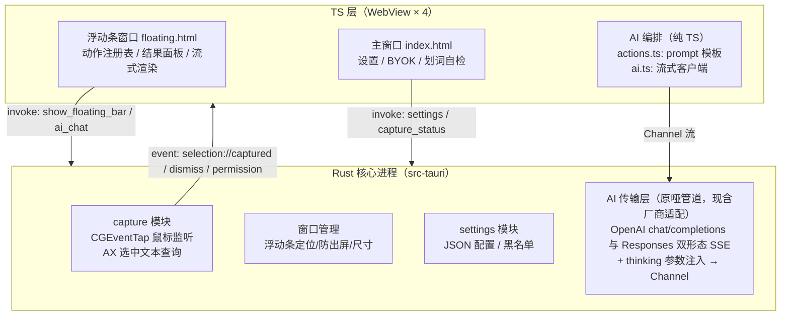
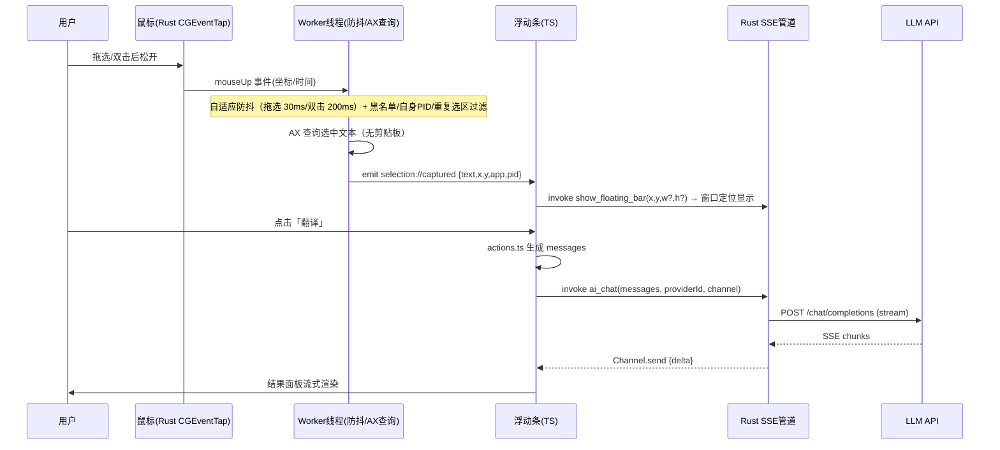

# 拾趣 · 架构设计

> v2.0 · 2026-09-19 · 配套 [01-产品定位与规划](./01-产品定位与规划.md) / [03-模块设计](./03-模块设计.md) / [04-技术选型](./04-技术选型.md)

## 1. 总体原则

1. **Rust 管不变的，TS 管多变的**：系统层（捕获/窗口/存储/传输）放 Rust——五年不随 AI 演进变化；AI 编排（动作、prompt、流式渲染、未来 agent）放 TS（WebView 内）——蹭 npm 生态的迭代速度。
2. **无障碍优先**：数据获取默认只走无障碍 API；兼容模式（常开兜底）在 AX 失败时模拟 ⌘C 取词并自动还原剪贴板。
3. **热路径零框架**：划词→弹条→流式首字这条链上不引入任何 AI 框架，保证延迟与体积。
4. **契约面最小**：Rust ↔ TS 之间只通过 Tauri command（请求/响应）+ event + Channel（流）三种通道通信，热路径契约面保持最小；全量命令清单以 `src-tauri/src/main.rs` 的 invoke_handler 注册为准。

## 2. 分层架构



### 进程与窗口模型

| 窗口 | label | 特性 | 生命周期 |
|---|---|---|---|
| 主窗口 | `main` | 880×620（min 780×520，tauri.conf.json），常规装饰 | 常驻（可关闭=隐藏） |
| 浮动条 | `floating` | 无边框/透明/置顶/不进任务栏/不抢焦点 | 常驻隐藏，选词时 show + 定位 |
| 识别/结果窗 | `ocr` | 复用 floating.html，无边框/透明/置顶/不抢焦点 | 常驻隐藏，OCR 取词/结果展示时 show |
| 全局提示 | `toast` | toast.html，无边框/透明/置顶/不抢焦点 | 常驻隐藏，notify 时 show |

> 浮动条采用「预建 + show/hide」而非每次 new window：省 50~100ms 创建延迟。

> Windows 下另有 `floating-panel` / `floating-menu` 两扇动态预建窗口（分离卡弹层，见 [03-模块设计 §B.1.1](./03-模块设计.md)）。

## 3. 关键数据流

### 3.1 划词→弹条→流式结果（热路径）



### 3.2 事件与命令协议（Rust ↔ TS 契约）

**Events（Rust → TS）**

| 事件 | 载荷 | 说明 |
|---|---|---|
| `selection://captured` | `{text, x, y, app, pid}` | 有效新选区（pid 供 pageurl 反查来源页面 URL） |
| `selection://dismiss` | `{}` | 单击空白（浮动条可见时才发），浮动条隐藏 |
| `capture://permission` | `{granted}` | 辅助功能授权状态变化（启动/自检时查询后发） |
| `hover://move` | `{x, y}` | 鼠标位置（**目标窗口视口坐标**，Rust 按光标落点在悬浮胶囊/结果窗之间路由，光标落在 Windows 分离卡弹层内也路由给胶囊窗口（坐标按胶囊原点换算）以维持驻留收起判定，~60Hz 节流），供前端合成 hover 与二级浮层 hover 驻留展开——非 key 窗口收不到 mouseMoved、WebKit 只给活动页面渲染 :hover |
| `hover://left` | `{}` | 光标从全部 hover 目标窗口（胶囊/结果窗/Windows 分离卡弹层）划出的瞬间补发一次给最后命中的窗口——分离卡下胶囊文档看不到弹层窗口边界，光标从弹层直接划走时收不到 mouseleave，二级浮层「延迟收起」靠这条边沿起算 |
| `floating://pop` | `{open, data}` | Windows 分离卡：向 `floating-panel` / `floating-menu` 推送二级浮层渲染数据（哑渲染端，结构见 docs/03 §B.1.1） |
| `floating://pick` | `{kind, key, rowY}` | Windows 分离卡：弹层窗口回传胶囊窗口执行（`action` / `menu-toggle` / `row-hover`（行 hover 变化上报，行命中在面板窗口检测、决策在胶囊）/ `pick:translate` / `pick:search` / `pick:obsidian`；rowY = 行侧菜单锚点） |
| `update://available` | `{status, current, latest?, url?, checkedAt}` | 更新检测结果（update.rs；启动后台检查与关于页手动检查后广播，status = available / upToDate / cooldown / failed） |
| `ocr://error` | `message`（字符串） | OCR 子进程识别失败提示（ocr.rs） |
| `nav://page` | `page`（字符串） | 定向发主窗口的页内导航（托盘菜单跳转指定设置页，如 `model`） |

**Commands（TS → Rust）**

> 本表只覆盖划词/结果窗热路径契约；全量命令（OCR、钉图、翻译 ×9、更新检测、应用选择等）以 `src-tauri/src/main.rs` 的 invoke_handler 注册清单为准。

| 命令 | 参数 | 返回 |
|---|---|---|
| `show_floating_bar` | `x, y, w?, h?` | 返回 `WindowPos`（实际落位，以 Rust 钳制为准）：跟随鼠标上方（胶囊水平中心对光标、卡片底边距光标 16px，屏顶放不下落到下方），含防出屏钳制 |
| `resize_floating` | `width, height, x?, y?` | 返回 `WindowPos`：展开结果面板时调整尺寸并保持不出屏 |
| `hide_floating_bar` | — | 隐藏 |
| `ai_chat` | `messages, providerId?, channel` | 建 SSE 请求（OpenAI chat/completions 与 Responses 双形态，按厂商注入 thinking 参数），流经 Channel 推送 |
| `get_settings` / `save_settings` | — / `settings` | JSON 配置读写 |
| `capture_status` | — | `{granted, axServiceOk, listenEventAccess, screenCaptureAccess, captureAvailable, platform}` |
| `request_listen_access` | — | 发起输入监控授权（系统自动注册二进制）；未通过时代开设置面板 |
| `open_accessibility_settings` | — | 打开系统设置隐私面板 |
| `entities::detect_dates` | `text` | NSDataDetector 日期实体识别（离线/确定性，中文相对时间对照当天解析），返回 `[{unix, duration, start, len}]` |
| `entities::detect_places` | `text` | NLTagger（NaturalLanguage 框架）地名 NER，`nameType` 方案的 PlaceName 标签，离线 on-device；返回地名 span 字符串数组 |
| `entities::open_in_calendar` | `start, end, title, allDay, url?, notes?, attendees?` | 本地拼 .ics 交给系统日历（预填新事件，可带链接/备注/受邀人）；时间串由 TS 计算传入，零 EventKit 权限 |
| `pageurl::frontmost_web_url` | `pid`（选区来源进程，captured 事件携带） | 按 pid 直连 AX，焦点窗口 AXWebArea → AXURL（选区来源页面链接，智能提取上下文/日历 URL 字段）；pid≤0/非浏览器/非 macOS → null |
| `obsidian::obsidian_append` | `relPath, content` | 把内容追加进 vault 内相对路径文件（目录/文件不存在则创建）；路径越界 vault 即拒绝，纯本地文件写入 |
| `app_picker::pick_vault_dir` | — | 目录选择面板（rfd），返回所选绝对路径；用户取消返回 null |
| `notify` | `message, kind?` | 全局 toast 轻提示（前端侧唯一提醒通道：WKWebView 不实现 `alert/confirm`，它们是静默空操作） |
| `set_floating_pops` | `target, data, trigX?, rowY?` | Windows 分离卡：推送二级浮层渲染数据与锚点（target = `panel` / `menu` / `close-panel` / `close-menu` / `none`；锚点 None = 沿用上次值） |
| `pop_ready` | `width, height` | Windows 分离卡：弹层窗口量得卡片尺寸后回调，Rust 按锚点定位（贴边翻转 + 防出屏钳制）并显示（胶囊像素不动） |
| `floating_pick` | `kind, key, rowY?` | Windows 分离卡：弹层点击回传，转发 `floating://pick` 给胶囊窗口 |

**Channel 流消息（ai_chat）**

```jsonc
{ "type": "delta",  "content": "…" }   // 增量文本
{ "type": "done",   "usage": {...} }   // 正常结束（含 token 用量，可空）
{ "type": "error",  "message": "…" }   // 网络/鉴权/中止错误
```

## 4. 存储模型

- `~/Library/Application Support/app.magpie.desktop/settings.json`（Rust serde 读写，内存 Mutex 缓存；曾用 identifier `app.shici.desktop`，首次启动自动把旧目录配置迁移到新目录）。下例为节选示意（落盘为 camelCase）；完整字段以 `src/shared/types.ts` 为准（与 Rust `settings.rs` 同一契约）：

```jsonc
{
  "providers": [{ "id": "p1", "name": "DeepSeek", "baseUrl": "https://api.deepseek.com",
                   "apiKey": "sk-…", "model": "deepseek-chat" }],
  "defaultProviderId": "p1",
  "actions": { "translate": true, "explain": true, "summarize": true },
  "appBlacklist": ["com.apple.Terminal", "com.apple.Passwords"],
  "debounceMs": 200
}
```

> 安全注记：MVP 将 Key 明文存于本机配置文件（与竞品普遍水平一致）；M2 迁移到系统钥匙串（keyring crate），已在 [03-模块设计 §C](./03-模块设计.md) 留有接口位。文档与 UI 需明示此现状。

## 5. 安全与隐私设计

1. **权限最小化**：仅申请辅助功能权限（macOS），用途在首次引导页讲清楚。
2. **密钥不进前端持久层**：Key 只在内存中经 command 传给 Rust 管道；WebView 的 localStorage 不存 Key。
3. **CSP**：生产构建启用严格 CSP；WebView 无远程内容加载。
4. **数据流向透明**：MVP 仅「选中文本 + prompt」发送至用户自配的 LLM API，无任何遥测（未来加遥测须默认关闭）。

## 6. 演进路径

前瞻路线、优先级与"不做清单"以 **ROADMAP.md** 为权威（与 01 §6 的战略方向同步维护），本节不再重复列表；架构侧落点已内化到 ROADMAP 对应条目与本文 §3 契约表。

## 7. 技术风险与对策

| 风险 | 等级 | 对策 |
|---|---|---|
| AX 在部分应用拿不到文本 | 高（固有） | 静默失败 + 自检页预期管理 + 兼容模式（常开的 ⌘C 兜底，已实现） |
| 浮动条多显示器 DPI 定位 | 中 | 统一 Logical 坐标换算 + 防出屏钳制，双屏实测纳入验收 |
| SSE 管道的中断/超时处理 | 中 | 连接超时 15s（无总超时，ai.rs）；流式中断经 error 事件呈现重试按钮 |
| CGEventTap 被系统禁用（空闲超时） | 低 | listen-only tap 不修改事件基本不会被禁；启动与 resume 时自检重建 |
| Key 明文存储 | 中 | M2 迁 keyring；README 明示 |
